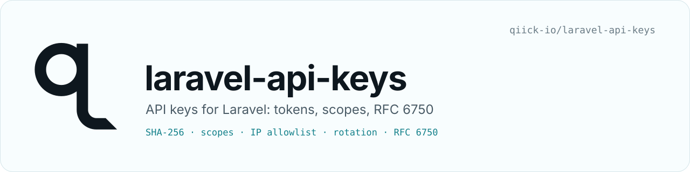

<p align="center">
  <picture>
    <source media="(prefers-color-scheme: dark)" srcset=".github/assets/header-dark.svg">
    <source media="(prefers-color-scheme: light)" srcset=".github/assets/header-light.svg">
    
  </picture>
</p>

# qiick/laravel-api-keys

> **Pre-release (0.x).** The public API may still change before 1.0.0: pin an exact version and read UPGRADING.md when you update.

Contract-only API key mechanics for qiick Laravel products: token issue/parse/verify,
fail-closed scopes, IP allowlist, RFC 6750 refusals in the fleet error format, rotation
grace, usage throttle, audit `api_key_id`, and test helpers.

**Products own** Eloquent models, migrations, permissions, scope enums, tenancy, and
HTTP middleware. This package does not register middleware; it does register
`api-keys:notify-expiring` (bind `ExpiryRecipientResolver`).

Part of the qiick fleet. Binding design:
`projects/qiick/packages/laravel-api-keys-design.md` in the knowledge base
(overlay: `decisions/2026-11-20-core-hardening.md`).

## Status

Beta `0.3.0-beta.3`. Public APIs may change in any 0.x release; see
[UPGRADING.md](./UPGRADING.md). Pin an exact version.

## Requirements

- PHP `^8.3`
- Illuminate console / contracts / http / notifications / support `^12.0 \|\| ^13.0` (never `laravel/framework`)

## Install

```bash
composer require qiick/laravel-api-keys:0.3.0-beta.3
php artisan vendor:publish --tag=api-keys-config
```

Set `API_KEYS_PRODUCT_PREFIX` (three-letter product code) before issuing tokens.

## Threat model (short)

| Topic | Contract |
| --- | --- |
| Proxies | `KeyContext::ip` / `ClientIp::from` MUST use `Request::ip()` only after `TrustProxies` is configured correctly. Never pass raw `X-Forwarded-For` / `X-Real-IP` from untrusted clients. |
| Enumeration | Format-miss and hash-miss return the **same** `401 invalid_token` body/headers. A dummy `hash_equals` runs when no candidates match. Pre-auth `FailedAttemptLimiter` is default-on in recipes. The public `key_prefix` is non-secret by design. |
| Failed-attempt brake | Buckets IPv4 by `/32` and IPv6 by `/64`. IPv4-mapped (`::ffff:a.b.c.d`) expands to dotted IPv4 before bucketing (same path as `IpAllowlist`). Null/empty/unparseable client IPs **skip** the brake (never share one bucket — that would lock out everyone behind a misconfigured proxy). Repository/infra exceptions are **not** counted. The brake counts only failed guesses (one atomic `AttemptLimiter::hit` each), so valid requests in flight never take a slot. Once the bucket is full, a guess over the limit **and** a correct key are both answered `429 too_many_requests`, so racing guesses reveal at most the limit's worth of outcomes per window. Shared egress / NAT: many clients behind one public IP share one bucket and can lock each other out; keep the recipe default **on** (20/min) and raise only with a clear threat model. Wire after `TrustProxies` so `KeyContext::ip` is the real client, not the LB. An IPv6 /64 per bucket leaves an attacker holding a /48 65,536 buckets: pass `maxPerMinutePerIpv6Slash48` (at least 1) for a second tier over the whole /48. |
| Redaction | Presented tokens / Bearer values MUST NEVER appear in exception messages, JSON bodies, logs, telemetry, activity properties, or `__debugInfo`. |
| Scopes | Fail-closed: whitespace, wrong case, duplicates, or non-vocabulary values → empty set → `403 insufficient_scope` (never 401). |
| Audit | Activity under a key carries `api_key_id` = the key’s **public UUID** via `Audit::withApiKeyId` (never the internal bigint; lowercase UUID; rejects non-UUID, nil UUID, and a conflicting existing `api_key_id`). |
| Rotation | `RotationService::rotate` refuses revoked/expired keys, `oauth_grant` rows, and unknown prefixes; invalid/negative/above-max grace → 0 (max default 168h). Legacy prefixes migrate to a **fresh canonical** token; with grace > 0, `previous_key_prefix` keeps the old token findable through the normal window. Products **must** `lockForUpdate` and write every returned field unconditionally (including `previous_key_prefix`, `last_rotated_at`, `token_version`). |
| Expiry claim lease | `api-keys:notify-expiring` claims with `expiry_notice_claimed_at` (app/worker clock, not DB `NOW()`), then stamps `expiry_notified_at` after send. Default lease is **900** s (`API_KEYS_EXPIRY_CLAIM_LEASE_SECONDS`). Keep worker clocks on shared NTP UTC — skew can reclaim a live claim early. Keep the lease above worst-case send latency — an in-flight send longer than the lease can be reclaimed and produce a **double notice**. |

## Token shape

`{product}_{live|test}_{id}{secret}` — three-letter product prefix, 8-character
public id, 32-character secret (A–Za–z0–9). **Version 2** (default) appends a
6-character base62 CRC32 checksum (GitHub construction); version 1 stays
accepted. The row stores SHA-256 of the **full** plaintext (including checksum)
and records `token_version` / `hash_algorithm`.

Scanner regex (product prefix `ppp`):

```text
\bppp_(?:live|test)_[A-Za-z0-9]{40}(?:[A-Za-z0-9]{6})?\b
```

See [docs/reference-schema.md](./docs/reference-schema.md) for the full column list.

## Quotas (minute / day / month)

`rate_limit_per_minute`, `rate_limit_per_day`, and `rate_limit_per_month` are
enforced as **fixed windows** opened by their first hit (decay 60 s /
86_400 s / 2_592_000 s). They are not calendar day or calendar month buckets.
A refusal carries `Retry-After`, `X-RateLimit-Limit`, `X-RateLimit-Remaining`
and `X-RateLimit-Reset`; `X-RateLimit-Reset` is the number of **seconds** until
the window resets (like `Retry-After`), not an epoch timestamp.
Durable calendar quotas are LATER (standards review L4).

Limits hold under concurrency: the authenticator counts a request first with
`AttemptLimiter::hit()`, one atomic increment that returns the new count, and
refuses it when that count is over the limit. A refused request hands back the
hits it took on every window, so it counts against none of them. It never
checks and then counts in two steps.

The package binds `CacheAttemptLimiter`, which counts with Laravel's own
`RateLimiter` on the cache store in `api-keys.cache_store`
(`API_KEYS_CACHE_STORE`; null means the default store). Redis is not
required: any Laravel cache store works, and the choice is yours. For
production, use a store that increments atomically across workers: Redis,
Memcached, DynamoDB, or the database store on MySQL or PostgreSQL.

- **File store:** not atomic. Parallel workers can let more attempts through
  than the limits, even on one server.
- **SQLite database store:** needs `transaction_mode => 'IMMEDIATE'` (PHP 8.4+)
  and a `busy_timeout`. Without them, parallel requests answer 503.
- **Window-start race:** Laravel resets a counter with `put()` when a window
  opens. Under load that reset can erase most of the window's count, so a
  window can admit up to just under twice its limit. It happens at most once
  per window and is accepted by design.

[docs/security.md](./docs/security.md) has the decision, the measurements and
the table of stores.

Boot does not resolve the store, so artisan keeps working. Run
`php artisan api-keys:check` in the deploy pipeline. It prints the active
limiter and exits 1 on invalid settings or on the null store, which keeps no
counters. It warns, without failing, on the file store, and on the array store
outside tests. If the store fails or does not count an attempt at request
time, the authenticator answers `503 service_unavailable`: the limits are
never skipped.

To count on another store or connection than `api-keys.cache_store`, bind your own:

```php
$this->app->singleton(AttemptLimiter::class, fn () => new CacheAttemptLimiter(Cache::store('redis')));
```

## Expiry notices (claim lease)

`api-keys:notify-expiring` takes a CAS lease on `expiry_notice_claimed_at`
before sending, with a fresh random `expiry_notice_claim_token`, for the
`expires_at` it selected. It stamps `expiry_notified_at` only after a
successful send, and only while the row still holds that token and expiry (see
`ExpiryNoticeClaimSql`). A run whose lease expired therefore cannot mark or
release the next run's claim, and a key rotated in between is not stamped as
notified for its new expiry. The lease cutoff is computed from the worker's
`Clock` (`$now`), not the database server clock.

Two operational risks (accepted as documented nits after #18):

1. **Clock skew.** Workers whose clocks disagree can reclaim a claim that is
   still live on another host. Run every notify worker on NTP-synced UTC.
2. **Send longer than the lease.** If delivery (mail, queue, webhook) exceeds
   `api-keys.expiry.claim_lease_seconds` (default **900**), another worker can
   win the CAS and send a second notice. Raise the lease, or keep sends short.

The legacy-format T−90 warning follows the same protocol with the same lease,
through `LegacyFormatWarningGate` (cache-backed by default): recipients are
resolved first, so a key with no recipient yet stays claimable; a failed send
releases the lease (only its owner can: the lease is a cache lock with an
owner token) and the next run retries; a worker that dies mid-send
leaves a lease that lapses after `claim_lease_seconds`; a sent warning is
marked permanently and never repeats. The cache must be shared by all workers.

## Max key lifetime

`api-keys.max_lifetime_days` (`API_KEYS_MAX_LIFETIME_DAYS`) is enforced on
rotation by the default `ConfigLifetimePolicy`: `RotationService` refuses an
expiry later than now + that many days, or no expiry at all. Unset disables
it. Any other value must be a whole number >= 1; anything else (`0`, `30abc`,
`thirty`) fails at boot instead of being silently cast. Bind your own
`Contracts\LifetimePolicy` to replace the default.

Issuance is product-owned (`TokenCodec::issue()` persists nothing), so check the
policy before inserting a new key; the same refusal is used on rotation:

```php
$expiresAt = $request->date('expires_at')?->toImmutable();

LifetimeAssertion::assertAllows(app(LifetimePolicy::class), $expiresAt, $clock->now());

$token = $codec->issue();
ApiKey::create([/* ... */ 'expires_at' => $expiresAt, 'key_hash' => $token->keyHash]);
```

## Exposed keys

`Contracts\CompromisedKeyRevoker` is the seam for automatic revocation when a
key is reported exposed (a secret-scanning partner callback, a manual report).
The package ships no scanner adapter (dated decision in `docs/decisions`): the
product verifies the scanner's request, then revokes and announces it:

```php
final class RevokeExposedKey implements CompromisedKeyRevoker
{
    public function revokeExposed(ApiKeyRecord $record, string $exposureSource, DateTimeImmutable $exposedAt): void
    {
        ApiKey::query()->whereKey($record->id())->update([
            'exposed_at' => $exposedAt,
            'exposure_source' => $exposureSource,
            'revoked_at' => $exposedAt,
            'revoked_reason' => RevocationReason::Exposure->value,
        ]);

        event(new ApiKeyExposed($record->publicId(), $exposureSource, $exposedAt));
    }
}
```

## Rotation (product persistence)

```php
DB::transaction(function () use ($key, $codec, $clock) {
    $locked = ApiKey::query()->whereKey($key->id)->lockForUpdate()->firstOrFail();
    $rotation = $rotationService->rotate($locked, $codec, $clock, config('api-keys.rotation_grace_hours'));

    // Write every field unconditionally (nulls when grace is 0;
    // previous_key_prefix is set when migrating a legacy prefix with grace).
    $locked->forceFill([
        'key_prefix' => $rotation->newKeyPrefix,
        'key_hash' => $rotation->newKeyHash,
        'previous_key_hash' => $rotation->previousKeyHash,
        'previous_key_valid_until' => $rotation->previousKeyValidUntil,
        'previous_key_prefix' => $rotation->previousKeyPrefix,
        'last_rotated_at' => $rotation->lastRotatedAt,
        'token_version' => $rotation->tokenVersion,
    ])->save();

    return $rotation; // show newPlainText once
});
```


## IP allowlist

`IpAllowlist::allows($ip, $stored)`: null/empty → allow all; non-list or
non-string entries → deny; zone-id client IPs (`fe80::1%eth0`) → deny.
IPv4-mapped forms (`::ffff:a.b.c.d`) expand to dotted IPv4 before
`IpUtils::checkIp` (mapped CIDR prefixes subtract 96); `::1` / `::` stay IPv6.
Prefix out of range (IPv4 0–32, IPv6 0–128) fails closed.
`ClientIp::from($request)` is `Request::ip()` only (configure TrustProxies).

## Scopes

Atoms match `^[a-z][a-z0-9-]*:(read|write)$` exactly (no trim/case-fold).
`ScopeSet::parseStored` is fail-closed: unknown, duplicate, whitespace, or
non-list input → empty set. `write` satisfies `read` on the same resource;
highest-per-resource drops a sibling `read` when `write` is present.

## Evaluation order

Extract the bearer first (`BearerTokenExtractor`: no trim; case-insensitive
`Bearer`), then call
`ApiKeyAuthenticator::authenticate($presentedToken, $context, $requiredScope)`:

1. Pre-auth `FailedAttemptLimiter` (IPv4 `/32`, IPv6 `/64`; default 20/min in
   recipes): a full bucket refuses at once; an `invalid_token` outcome is
   counted, and answered `429` when it goes over the limit →
2. Token format (`TokenCodec::prefixOf`, including legacy matchers when configured) →
3. Lookup by `key_prefix` / in-grace `previous_key_prefix` + `hash_equals`
   (dummy compare on miss; row `hash_algorithm`) →
4. Refuse `credential_kind = oauth_grant` as `401 invalid_token` →
5. Revoked / expired / unknown `token_version` →
6. Actor (`KeyAuthorizer::authorizeActor`); then, the credential being valid,
   a full failed-attempt bucket still answers `429` →
7. IP allowlist →
8. Request restrictions (`KeyRestrictions` / `RequestRestrictionsEvaluator`;
   malformed or denied → `403 request_not_allowed`; scheme/host compared
   case-insensitively). Origin wildcards must sit on a registrable domain:
   `*.example.com` yes; `*.com`, `*.co.uk`, `*.github.io` (anyone can register
   a sibling there) no, per a bundled snapshot of the Public Suffix List.
   `new RequestRestrictions(...)` validates its own lists
   and throws `InvalidArgumentException` on a pattern the evaluator would not
   understand, so a hand-built instance cannot fail open →
9. Scopes: expand → owner ceiling via `scopesCreatorMayGrant` on the **record**
   (C1: the product decides ownerless/creator-less keys; write may demote to
   read) → collapse highest-per-resource → required scope / `authorizeScopes` →
10. Resource restrictions (`authorizeResources` when `restrictions.resources`
    is non-empty; denial → `403 request_not_allowed`) →
11. Per-key rate limits (`KeyAuthorizer::rateLimit()` list, else minute/day/month
    defaults from the row; `AttemptLimiter` buckets) →
12. Usage record (`UsageRecorder` throttle; `last_used_user_agent`; write
    failures are reported, not thrown).

### Wiring the failed-attempt brake (recipe default ON)

The package binds `FailedAttemptLimiter` on the bound `AttemptLimiter`, sized by
`api-keys.failed_attempts_per_minute` (`API_KEYS_FAILED_ATTEMPTS_PER_MINUTE`,
default 20; `0` disables). Pass it to the authenticator; bind your own (for
example with the IPv6 /48 tier) to replace it:

```php
$auth = new ApiKeyAuthenticator(
    // ...
    failedAttemptLimiter: app(FailedAttemptLimiter::class),
);
```

`php artisan api-keys:check` also builds the token codec, so an empty
`product_prefix`, a `token_version` other than 1 or 2, or an `environment` other
than `live`/`test` fails the deploy check.

Pass `KeyContext::ip` from `ClientIp::from($request)` only after `TrustProxies` is correct.
Clients behind CGNAT / shared office egress share one IPv4 bucket — tune `maxPerMinute`
up only if false lockouts outweigh credential-stuffing risk.

Refusals are `ApiKeyRejection`: `401 invalid_token` and `403 insufficient_scope`
carry RFC 6750 `WWW-Authenticate`; `403 ip_not_allowed`, `403 request_not_allowed`,
and rate-limit responses do not. Pass an empty string to the authenticator when
the extractor returns `null`. This case uses `ApiKeyRejection::missingToken()`
and challenges with `Bearer realm="api-keys"` without an `error` parameter
(RFC 6750 §3.1). The JSON still carries `invalid_token` and the failed-attempt
brake still counts the refusal. Every `insufficient_scope` names the scope the
request required (`scope="items:write"`, and `scope` in the JSON) when there is
one. With `api-keys.resource_metadata_url` set to your RFC 9728
protected-resource metadata (absolute https), Bearer challenges also carry
`resource_metadata="<url>"`, as the MCP authorization spec asks. When the attempt store (Redis, Memcached) is
down, the request fails closed as `503 service_unavailable` (the cause goes to
the exception reporter), never a bare 500. Format-miss and hash-miss share the same
body/headers. Presented tokens are `#[SensitiveParameter]` and never appear in
messages, `render()`, `__debugInfo`, JSON, or serialize output.

## Legacy matchers (product-owned)

The package ships the `LegacyTokenMatcher` contract and registration point only —
no product-specific matcher classes. Boot **fails** when `api-keys.legacy_matchers`
is non-empty without an **absolute** ISO-8601 timestamp with offset (`DATE_ATOM`)
or UTC `Z` (`API_KEYS_LEGACY_ACCEPT_UNTIL` / `api-keys.legacy.accept_until`), for
example `2027-01-01T00:00:00Z` or `2027-01-01T00:00:00+00:00`. Relative strings
(`now`, `tomorrow`, `+10 years`) and date-only values are rejected.

`TokenCodec::prefixOf($token, $now)` / `legacyMatcherFor($token, $now)` require `$now`.
A matcher is used only when `isAccepting($now) && now < min(config, acceptUntil())`
(exactly-at = rejected). Matcher output must be a **strict** prefix leaving at least
`max(20, matcher->secretLength())` characters (Externa `ek_` secret = **31**).
`prefixOf` must also recognise the bare stored `key_prefix` so rotation can migrate
the row. `legacyMatcherFor` returns null for canonical tokens.

Dispatch `Events\LegacyTokenUsed` only after **successful** authentication, using
`AuthenticationResult::$legacyMatcherClass`:

```php
// Product-owned matcher (example shape only — not shipped by this package):
// ek_ + 9 alnum public id + 31 alnum secret (real Externa format)
final class EkLegacyTokenMatcher implements LegacyTokenMatcher { /* ... */ }

// config/api-keys.php
'legacy_matchers' => [EkLegacyTokenMatcher::class],
'legacy' => [
    // Absolute ISO-8601 with offset (DATE_ATOM) or UTC Z — not "tomorrow" / "+10 years"
    'accept_until' => env('API_KEYS_LEGACY_ACCEPT_UNTIL'), // e.g. 2027-01-01T00:00:00Z
],

$result = $authenticator->authenticate($presented, $context);
if ($result->legacyMatcherClass !== null) {
    event(new LegacyTokenUsed(
        $result->record->keyPrefix(),
        $result->legacyMatcherClass,
        /* matcher acceptUntil from your registry */,
    ));
}
event(new ApiKeyAuthenticated(
    $result->record->publicId(), // the public UUID, never the internal row id
    $result->record->keyPrefix(),
    $result->usedPreviousSecret,
    $context->ip,
));
```

Pest helpers (`assertTokenAbsentFrom`, `assertInvalidToken`, `assertInsufficientScope`,
`assertIpNotAllowed`, `assertLegacyTokenUsed`) ship under `Qiick\ApiKeys\Testing\` via
**autoload-dev** only. Consumer apps should `require` `vendor/qiick/laravel-api-keys/src/Testing/functions.php`
from their `Pest.php` (do not put them on production `autoload.files`).

## Public API and deprecation policy

The frozen public surface (classes, config keys, env names, commands, events and
wire formats) is listed in [docs/public-api.md](./docs/public-api.md); anything
else in `src/` is `@internal`. This package follows
[Semantic Versioning](https://semver.org/spec/v2.0.0.html):

- **Deprecation in minor releases:** a deprecated public API (class, method,
  interface, config key or environment variable) is marked `@deprecated` with
  its replacement, recorded under "Deprecated" in `CHANGELOG.md` and in
  `UPGRADING.md`, and keeps working for at least one minor release. A renamed
  config key or env name is still read as a fallback until removal.
- **Removal in major releases only:** nothing deprecated is removed within the
  same major version; removals happen at the next major (`2.0.0`).
- **Pre-1.0:** in `0.x`, breaking changes are recorded in `UPGRADING.md` before
  each tagged release. From `1.0.0` the public API above is frozen.

## Development

```bash
composer update
composer test      # Pest
composer lint      # Pint
composer analyse   # PHPStan level max
```


No `composer.lock` is committed (library). CI resolves with `--prefer-lowest` and stable
across PHP 8.3/8.4/8.5 × Laravel 12/13.

## Security

Private vulnerability reporting: see [SECURITY.md](./SECURITY.md).

## License

MIT. See [LICENSE](./LICENSE).
